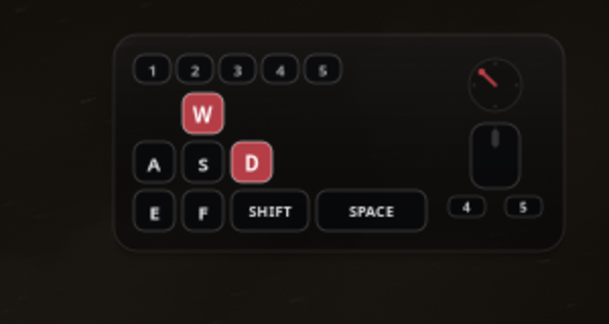

# dbd-input-overlay

Kleines, transparentes Input-Overlay für Dead by Daylight unter KDE Plasma Wayland.



Das Overlay liegt als Layer-Shell-Fläche oben rechts über dem Spiel, nimmt keinen Fokus und lässt Mausklicks durch. Es liest Tastatur und Maus direkt aus `/dev/input/event*`, ohne Root, ohne Injection und ohne Zugriff auf den Spielprozess. GPU Screen Recorder nimmt es bei einer Monitor-Aufnahme mit auf.

## Funktionen

- WASD, E, F, Space, Shift, 1 bis 5
- Maus: links, rechts, Mitte, Zurück/Vorwärts (M4/M5)
- Mausbewegungsrichtung als kleiner Kompass mit auslaufendem Zeiger
- Mausrad-Richtung als kurzer Pfeil
- Klick-durchlässig, kein Fokusklau
- Konfigurierbare Größe, Transparenz und Akzentfarbe
- Demo-Modus ohne Spiel
- Kein Root, kein Spiel-Hook

## Voraussetzungen

- KDE Plasma 6 auf Wayland (getestet mit KWin 6.8)
- `gtk4`, `gtk4-layer-shell`, `python-gobject`, `python-evdev`

Installation unter CachyOS/Arch:

```bash
sudo pacman -S --needed gtk4 gtk4-layer-shell python-gobject python-evdev
```

Dein Benutzer braucht Lesezugriff auf die Eingabegeräte. Bei einer aktiven Sitzung setzt logind die ACL normalerweise selbst. Alternativ:

```bash
sudo usermod -aG input "$USER"
```

Danach neu einloggen.

## Starten

```bash
./run.sh
```

Ohne Spiel testen:

```bash
./run.sh --demo
```

Overlay beenden: `Strg+C` im Terminal oder

```bash
pkill -f 'dbd_overlay'
```

## Monitor wählen

Standardmäßig landet das Overlay auf dem aktiven Monitor. Für DBD auf einem anderen Monitor:

```bash
./run.sh --output DP-2
```

Monitor-Namen anzeigen:

```bash
kscreen-doctor -o
```

## GPU Screen Recorder

Das Overlay ist nur in der Aufnahme, wenn der **Monitor** aufgenommen wird, nicht ein einzelnes Fenster.

```bash
gpu-screen-recorder -w DP-1 -o dbd.mp4 -f 60 -a default_output -c mp4
```

## Konfiguration

`~/.config/dbd-input-overlay/config.toml` anlegen. Alle Werte sind optional.

```toml
output = "DP-1"
scale = 1.0
margin = 16
panel_alpha = 0.28
accent = "#c2414b"
font = "Sans"
show_numbers = true
show_mouse = true

# Optional: Gerät per Namensausschnitt festnageln
# keyboard_device = "Keychron"
# mouse_device = "YJX"
```

CLI-Optionen überschreiben die Datei:

```bash
./run.sh --scale 0.85 --panel-alpha 0.2 --no-numbers
./run.sh --list-devices
```

`--panel-alpha 0.0` zeigt nur noch die Keycaps ohne Karte. `--no-mouse` blendet den Mauscluster aus.

## Tasten-Mapping

| Anzeige | Taste |
|---|---|
| 1-5 | 1-5 |
| W A S D | W A S D |
| E F | E F |
| SHIFT | linke oder rechte Shift |
| SPACE | Leertaste |
| M4 / M5 | Seitentasten der Maus (BTN_SIDE/BTN_EXTRA, je nach Maustreiber auch BTN_BACK/BTN_FORWARD) |

Die mittlere Maustaste wird als Rad-Klick im Mauscluster angezeigt.

## Warum kein fertiges Tool?

- `showmethekey`: gut für Tastatur unter Wayland, aber keine Mausbewegung.
- `Keyviz`: unter Linux nur X11.
- OBS `input-overlay`: Tastatur/Maus unter Wayland nicht zuverlässig.
- `KeyOverlay`/`Seekey`: jung, keine Bewegungsrichtung, KDE-Fallback wackelig.

Dieses Projekt kombiniert einen schlanken evdev-Reader mit einer GTK4-Layer-Shell-Fläche. Die Layer-Shell-Unterstützung von KWin übernimmt das Always-on-top über Vollbild.

## Anti-Cheat

Das Programm liest ausschließlich Kernel-Eingabeereignisse und zeichnet ein separates Overlay-Fenster. Es injiziert nichts in den Spielprozess, liest keinen Spielspeicher und sendet keine Eingaben ans Spiel. Es verarbeitet nur die oben genannten Tastencodes, schreibt keine Logs und hat keine Netzwerkfunktion. Das entspricht dem üblichen Vorgehen von Streaming-Overlays. Eine Garantie für EAC-Verhalten gibt es trotzdem nicht.

## Entwicklung

```bash
python -m unittest discover -s tests -v
./run.sh --demo
```

Die Kernlogik (Tastenzustand, Geräte-Mapping, Layout, Konfiguration) ist mit 36 Unit-Tests abgedeckt. Die Darstellung wurde mit DBD im Vollbild und GPU Screen Recorder verifiziert.

## Bekannte Grenzen

- Nur KDE Plasma Wayland mit Layer-Shell. GNOME funktioniert nicht.
- Es wird ein Mauszeiger-Gerät gelesen. Bei mehreren Mäusen per `mouse_device` auswählen.
- Kein Tray. Start und Stop erfolgen über Kommando oder Desktop-Launcher.
- Direct-Scanout kann das Overlay in seltenen Fällen verdecken. Falls das passiert, DBD im randlosen Fenstermodus starten.
